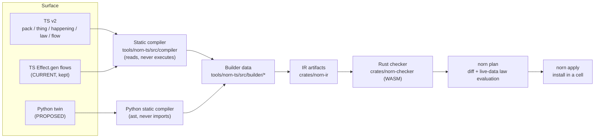
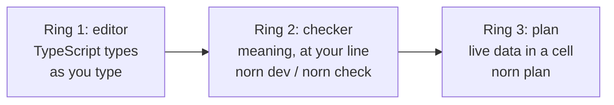
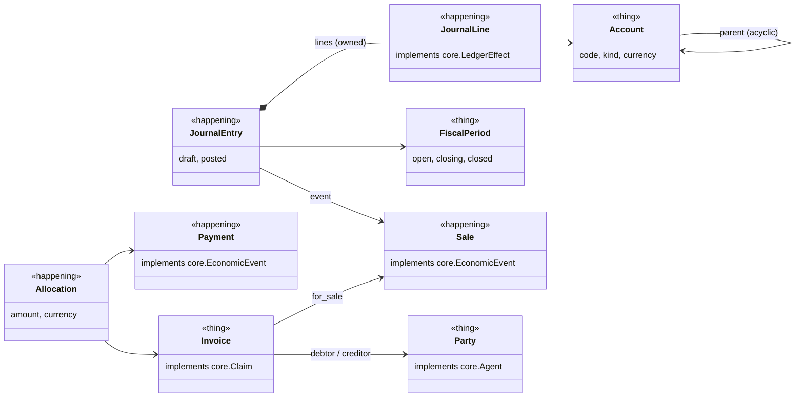
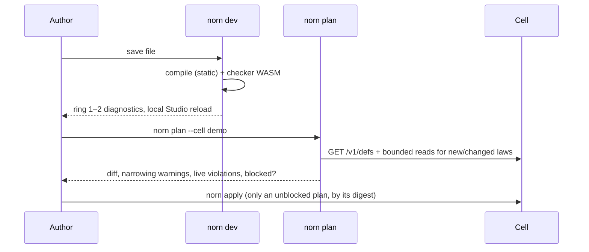

# Authoring DX v2

Status: **design spec, approved direction 2026-11-09. Nothing here is implemented yet** unless a row says CURRENT. It changes how definitions are written, not what they mean. The IR (`crates/norn-ir`) and the Rust checker (`crates/norn-checker`) stay as they are, except for the three engine gaps in [§8](#8-engine-gaps-specified-here-not-built).

Markers used throughout:

- **CURRENT**: works on `main` today, in `tools/norn-ts` or the Rust crates.
- **PROPOSED**: this spec, to be built ([#1176](https://github.com/Norn-cloud/norn/issues/1176) tracks the units).
- **GAP**: needs an engine change; specified in §8.

Read with the [authoring reference](README.md) and the [core specs](../spec/core/README.md). Where this spec and the 2026-11-01 decision record disagree on meaning, the decision record wins; this spec only governs syntax and tooling. Related: #521 (one developer loop), #58 (backend leaks that `law()` and typed lambdas remove), #1126 and #938 (defeasibility), #565 (generated proofs).

## 1. The problem, measured

Today's authoring is JSON spelled in TypeScript. In [`scripts/demo/constitution.source.ts`](../../scripts/demo/constitution.source.ts) the `Conservation` law is 16 lines. One of them carries meaning:

```ts
response: { kind: "predicate", expression: "self.input_fine_g == self.output_fine_g + self.loss_fine_g" },
```

The rest is plumbing the compiler could derive: the artifact id (`constitution.fine_mass.law`) and the law id (`constitution.fine_mass`) written separately; `"constitution.Melt"` written four times (scope root, `objectTypes`, `subject`, dependency); `lawVersion: "0.1"`; `provenance.sourcePath` repeating the file's own path; a hand-pinned dependency on `constitution.Melt.entity@1.0.0` that goes stale when Melt's version changes. And the meaning itself is an untyped string, so a typo in `output_fine_g` only surfaces at the Rust checker.

The same pattern runs through the registry:

| Source | Plumbing written by hand |
|---|---|
| [`registry/core/src/physics.ts`](../../registry/core/src/physics.ts) | `cardinality: { to, from, required }` on every link; string targets (`"core.EconomicEvent"`) for self-references |
| [`registry/core/src/commerce.ts`](../../registry/core/src/commerce.ts) | Lifecycle as `{ id, from: [...], to }` triples: states are strings, so a typo in `from` is a checker error, not an editor error |
| [`registry/core/src/restatement.ts`](../../registry/core/src/restatement.ts) | Three artifacts to say "a reviewer may approve": `Norn.action` (`effect.kind: "fire_transition"`), `Norn.access` (role rule) and the lifecycle transition, cross-linked by id |
| [`registry/packs/erpnext/records.ts`](../../registry/packs/erpnext/records.ts) | Mapping transforms as ZEN strings (`"'erpnext/demo/Item/' + input.name"`); a source schema `sha256` pinned by hand |
| [`registry/packs/erpnext/erpnext.pack.ts`](../../registry/packs/erpnext/erpnext.pack.ts) | ~90 hand-written term rows, most of them `"<field> field of <doctype>"` |

## 2. Principle

> **Explicit about meaning, inferred about plumbing.**

| Explicit (the author writes it, the reviewer reads it) | Inferred (the compiler derives it, the reviewer never sees it) |
|---|---|
| States and transitions | Artifact ids, namespaces, `<name>.entity` / `.interface` / `.action` / `.law` / `.rule` suffixes |
| Who may act (roles) | Versions (from the pack), dependency lists and pins |
| What must hold (laws, guards) and when | Artifact kinds, `lawVersion`, `entityVersion`, `irVersion` |
| Named failures | Provenance and `sourcePath` |
| Effects on the outside world (Functions, connector write-back) | Scope boilerplate (`scope.root`, `objectTypes`, `subject`, `scopeRequired`) |
| Identity (business keys), units, currencies | Cardinality JSON, inverse ids, generated Run types and decision tables |

Three consequences:

1. **One way to say each thing.** If two spellings lower to the same IR, one of them is deprecated, except `Effect.gen` flows, which stay accepted (§4.6).
2. **References are values.** You import `Invoice` and pass it; you never write `"accounting.Invoice"`. A missing import is an editor error.
3. **Lambdas are compiled, never run.** Every `o => ...` in a law, guard, derivation, mapping or question is read by the static compiler (the same TypeScript Compiler API pass that handles `Norn.expression` today, `tools/norn-ts/src/compiler/`) and lowered to a norn-expr (ZEN) expression. No string expressions in v2.

## 3. Pipeline



The builder layer (`tools/norn-ts/src/builder/`) is already the single lowering target of hand-written definitions and the syntax compiler (`builder/index.ts`). v2 adds a new front end above it, not a new IR. The Python twin emits the same builder data as canonical JSON.

## 4. Primitives

All signatures are PROPOSED. They are written as `.d.ts` declarations for `@norn/authoring/v2`. Each subsection ends with its Python twin. Value-type helpers (`text`, `money`, ...) are listed once in §4.2.

### 4.1 `pack`

```ts
declare function pack<
  const Name extends string,
  const Req extends ReadonlyArray<PackRef>,
  const Exp extends ReadonlyArray<Definition>,
>(
  name: Name,                       // lower-case dotted namespace: "accounting"
  spec: {
    version: SemVer                 // every artifact in the pack gets this version
    title?: string
    requires: Req                   // packs whose exports this pack may reference
    exports: Exp & CheckRequires<Exp, Req>  // type error if an export references a pack not in `requires`
  },
): Pack<Name, Req, Exp>
```

- Namespace: every definition in the pack is `<name>.<Local>`. A pack file contains definitions; `pack()` declares the namespace, version and boundary.
- `CheckRequires` is the Effect Layer idea: each definition carries its referenced packs in its type (`Definition<R>`), and `exports` fails to typecheck unless `R ⊆ Req`. The error names the missing pack: `Type 'Pack<"core">' is missing in 'requires'`.
- An unexported definition is pack-private: other packs cannot import it (enforced by the checker's composition pack, below).
- Lowers to the existing **composition pack** (`business_pack`, `packKind: "composition"`, `CompositionPackRoot` in `crates/norn-ir/src/business_pack.rs`): `provides` ← export names, `artifacts` ← every compiled artifact with pinned versions, `instances[].imports` ← `requires`. The TS builder has no composition-pack constructor yet (PROPOSED unit).

Python:

```python
accounting = pack("accounting", version="0.1.0", requires=[core.pack], exports=[Party, Account, ...])
```

### 4.2 `thing`, `happening` and their interfaces

```ts
declare function thing<const N extends string, const P extends Props, const I extends Ifaces = [], const L extends Links = {}, const M = undefined>(
  name: N,                          // PascalCase local name; qualified as <pack>.<N>
  spec: EntitySpec<P, I, L, M>,
): ObjectType<N, Effective<P, I, L, M>>

declare function happening<...same generics>(name: N, spec: EntitySpec<P, I, L, M>): ObjectType<N, ...>

declare namespace thing     { function interface<...>(name: N, spec: InterfaceSpec<P, L>): Interface<N, ...> }
declare namespace happening { function interface<...>(name: N, spec: InterfaceSpec<P, L>): Interface<N, ...> }

interface EntitySpec<P, I, L, M> {
  description?: string
  extends?: ObjectType<string, unknown>           // at most one supertype
  implements?: I                                  // imported interfaces, never strings
  props: P                                        // { [id]: Prop<T> }
  links?: L                                       // { [id]: Link<T> }
  key?: ReadonlyArray<keyof Effective<P, I, L, M> & string> | Record<string, ReadonlyArray<...>>
  machine?: M                                     // §4.4
  derive?: { [id: string]: (self: Self<P, I, L>) => Value }  // same-object computed props
  pathEquations?: Record<string, [Path<Self>, Path<Self>]>
  markings?: ReadonlyArray<Marking>
}
```

`thing` / `happening` is the role: meaning, so explicit (`role: "thing" | "happening"` in EntityIR v2). Interfaces are `thing.interface(...)` / `happening.interface(...)`, carry no defaults, and may declare `laws` that every implementation inherits.

Plumbing rules:

- `key` omitted: if `props.id` exists it is the primary key, otherwise the checker's existing missing-identity rule fires. `key: ["number"]` names a business key `primary`; the record form names several.
- `implements` merges the interface's properties and links into the type (`EffectiveProperties` in `profile/norn-authoring.d.ts` does this today for properties). An implementation may narrow a link target or tighten cardinality, never widen it.
- `status` is never declared when `machine` is present: the machine generates the enum property.

Value types (all PROPOSED spellings over existing `PropertyType`s in `builder/entity.ts`):

| Helper | Lowers to |
|---|---|
| `id()` | `text`, part of primary key |
| `text({ format? })` | `text` |
| `int()` | `integer` |
| `decimal(scale, { unit? })` | `decimal` |
| `qty(scale, unit)` e.g. `qty(3, "g")` | `decimal` with UCUM `unit` |
| `money(scale, currencyProp)` e.g. `money(2, "currency")` | `decimal` with `currencySource` |
| `rate(scale, currencyProp, perUnit)` | `decimal` with `currencySource` + `perUnit` |
| `currency()` | `ref("iso4217.currency_code")` |
| `bool()`, `date()`, `timestamp("utc" \| "offset")`, `duration()` | the matching kind |
| `oneOf("a", "b")` | `enum` |
| `value(core.code)` | `ref` to an imported registry value type (replaces `Norn.ref("core.code")`) |
| `.optional()`, `.default(v)`, `.marked(m)` | `nullable`, `default`, `markings` |

Money and quantity are branded in the type system (`Money<"currency">`, `Qty<"g">`), so `amount + weight` is an editor error; the checker's unit admission (`unit_admission.rs`) still decides.

`derive` lowers to `PropertyDecl.computed` (`crates/norn-ir/src/entity_v2/object.rs`, a ZEN expression over the object's own properties). The IR has it; `builder/entity.ts` does not expose it yet (PROPOSED unit). Derivations across links are questions (§4.7), not stored properties.

Python:

```python
@accounting.thing(implements=[core.Agent])
class Party:
    id: Id
    display_name: core.display_name
    kind: Literal["person", "organization"]
```

Interfaces: `@accounting.thing.interface` / `@accounting.happening.interface`. Value types are annotations (`Money["currency", 2]`, `Qty["g", 3]`, `Currency`, `Date`, `Timestamp`).

### 4.3 `link`

```ts
declare namespace link {
  function one<T extends Target>(target: T | (() => T)): LinkBuilder<T, "one">
  function many<T extends Target>(target: T | (() => T)): LinkBuilder<T, "many">
}
interface LinkBuilder<T, To extends "one" | "many"> {
  required(): this        // cardinality.required
  unique(): this          // inverse side is "one" (default inverse is "many")
  owned(): this           // composition: only on link.many; the child cannot exist without this parent
  inverse(id: string): this
  acyclic(): this         // self-links only
  describe(text: string): this
}
```

- `link.one(Account)` → `LinkDecl { target: "accounting.Account", cardinality: { to: "one", from: "many" } }`.
- `() => T` defers the reference for self-links and cycles (Drizzle's `references(() => t.id)`), replacing string targets like `"core.EconomicEvent"`.
- `.owned()` on `lines: link.many(() => JournalLine).owned()` lowers to the child-side link `entry: to one, from many, required` (generated if the child does not declare it, named by `.inverse()` or the parent's camel-cased name) plus `createLinks` on the generated create action, so lines are created as owned drafts of their entry. Deletion follows the existing typed-link hierarchy rule (`link_targets_are_typed_and_hierarchy_deletes_cannot_dangle_them`).

Python: `lines = link.many(lambda: JournalLine).owned()`, `parent = link.one(lambda: Account).acyclic()`.

### 4.4 `machine` (XState v5 shape)

```ts
type Machine<S extends string, E extends string, Self> = {
  initial: NoInfer<S>
  states: { [K in S]: StateNode<S, E, Self> }
}
type StateNode<S, E, Self> = {
  on?: { [Ev in E]?: NoInfer<S> | Transition<S, Self> }
  after?: { days?: number; hours?: number; minutes?: number; to: NoInfer<S> }
  description?: string
} | Final
type Transition<S, Self> = {
  to: NoInfer<S>
  by?: Role | ReadonlyArray<Role>      // who may send this event
  when?: (self: Self) => boolean        // guard
  refuse?: string                       // named refusal when `when` is false
  run?: FlowDef                         // flow started when the transition commits
  input?: Props                         // typed event payload (stored on the event)
}
declare function final(opts?: { immutable?: boolean }): Final
```

- `S` is inferred from the keys of `states`; every target (`to`, shorthand string, `initial`, `after.to`) is `NoInfer<S>`, so `"psoted"` is a TypeScript error at the typo. Events are the keys of `on` across all states; the type exports `Invoice.events.post` as a typed handle for flows, access and questions.
- Lowering, all to existing IR:

| Surface | IR |
|---|---|
| the machine | enum property `status` + one `LifecycleDecl` (`builder/entity.ts`) |
| `initial` | `LifecycleDecl.initial` |
| `final()` / `final({ immutable: true })` | `terminal` / `terminal` + `immutable` |
| each event `e` from states `A, B` to `T` | one `TransitionDecl { id: e, from: [A, B], to: T }` |
| the same event from states with different `to`, `when`, `refuse` or `by` role sets (an omitted `by` counts as a role set) | **compile error** `NORN-MACHINE-EVENT-CONFLICT` (PROPOSED code). A `TransitionDecl` has one target and one guard set, and one generated access rule cannot keep per-state role sets apart, so one event cannot carry different behavior per state; the author names two events |
| `when` | `TransitionDecl.guards` (lambda → ZEN) |
| `refuse` | `TransitionDecl.guardRefusalCode` |
| each event | one generated `ActionIR` `<pack>.<type>.<event>` with `effect: fire_transition` (`builder/action.ts`) |
| `by` | one generated `AccessIR` rule permitting that action for those roles (`builder/access.ts`) |
| no `by` | no access rule: no person may send the event; only rules, flows and timers inside the pack can |
| `after` | a generated `decide` RuleIR (`builder/rule.ts`): trigger `transitioned` into the state emits a timer; the timer event fires the transition if the object is still in that state (the same timer pattern `lower-flow.ts` uses for `sleep`) |
| `run` | a generated `decide` RuleIR with trigger `transitioned` that emits the flow's `start` event |

`after: { at: self => self.due_date }` (an absolute deadline) is **deferred**: generated timers are relative (`afterMillis`), and a decision has no clock. Use a law with `within` (§4.5) for deadline obligations until absolute timers exist.

Python:

```python
machine = Machine(
    initial="draft",
    states={
        "draft": {"on": {"post": {"to": "posted", "by": Accountant, "when": lambda e: e.balanced}}},
        "posted": final(immutable=True),
    },
)
```

Python has no `NoInfer`; state and event names are checked by the Python compiler (ring 2) with the same message as TypeScript's ring 1 error. A pyright plugin is an open question.

### 4.5 `law`

```ts
declare function law<T extends ObjectType | Interface>(
  name: string,                          // snake_case, unique within its subject
  spec: {
    on: T                                // the subject: an imported type
    when?: (self: SelfOf<T>) => boolean  // condition
    must?: (self: SelfOf<T>) => boolean  // modality "always"
    never?: (self: SelfOf<T>) => boolean // modality "never"
    eventually?: (self: SelfOf<T>) => boolean
    within?: { days?: number; hours?: number } | { before: (self: SelfOf<T>) => Date }  // `before`: a bare read of a timestamp property only
    severity?: "error" | "warning" | Override   // default "error"
    unless?: ReadonlyArray<Exception<T>>        // GAP §8.1
    because: string                      // rationale, required
    id?: string                          // codemod only: keep an existing law id (see below)
  },
): Law<T>
type Exception<T> = { name: string; when: (self: SelfOf<T>) => boolean; because: string }
type Override = { override: { fixWithin: { days: number }; by: Role } }   // GAP §8.2
```

Exactly one of `must` / `never` / `eventually` is required (a type error otherwise).

Lowering to `LawIR` (`builder/law.ts`, `crates/norn-ir/src/verification.rs`):

| Surface | LawIR member | Inferred from |
|---|---|---|
| `name` | `id` = `<pack>.<type>.<name>`; artifact `<id>.law` | pack + subject |
| `id` (optional, codemod only) | `id` = the given value verbatim; artifact `<id>.law`. The codemod (§11) sets it whenever a source id differs from the derived one (`constitution.fine_mass` vs derived `constitution.Melt.fine_mass`) so the artifact id and bytes stay identical; new laws omit it | existing artifact |
| `on` | `subject`, `scope.root = { kind: "entity" }`, `scope.objectTypes` | the import. `scope.objectTypes` is `[subject]` only: `governing_laws.rs` refuses any other value (`UnsupportedUntilB2`), so types the lambdas read are not listed there; link reads need the declared read set (§8.3) |
| `when` | `condition` | lambda → ZEN |
| `must` / `never` / `eventually` with a lambda | `modality` + `response: { kind: "predicate" }` | lambda → ZEN |
| `must` / `never` / `eventually` with `invariant(Type, "id")`, `action(Ref)` or `transition(Type, "property", "id")` (PROPOSED helpers) | `response: { kind: "invariant" \| "action" \| "transition" }` naming the existing member, never a second expression copy (`LawResponse`, `crates/norn-ir/src/verification.rs`) | the codemod needs these for laws such as `registry/core/src/restatement.ts` (`invariant`); a source using a response form with no helper yet stays in today's syntax |
| `within` | `timing` (`within` / `before_deadline`). `before` lowers only when the lambda is a bare read of a timestamp property (`self.due_at`): `LawTiming::BeforeDeadline` stores a property name, so a computed deadline such as `addDays(self.due_date, 3)` is a compile error until the IR gains an expression form | |
| `severity` | `severity` | |
| `because` | `rationale` | |
| — | `lawVersion`, `owner` (= pack), `provenance`, `dependencies` | compiler |

Laws declared on an interface lower once per interface; every implementation inherits them, and the checker refuses an implementation that weakens one (`law.model.weakens_inherited`, CURRENT).

**Lambda subset** (shared by laws, guards, derivations, mappings and questions). The compiler lowers TypeScript syntax to norn-expr as checked by `norn-zen/6` (`crates/norn-expr/README.md`):

| TypeScript | norn-expr |
|---|---|
| `a === b`, `a !== b`, `<` `<=` `>` `>=` | `==`, `!=`, ordering. Ordering on `date` / `timestamp` properties lowers each operand through `date(...)` / `timestamp(...)` (`due_date >= issue_date` becomes `date(self.due_date) >= date(self.issue_date)`), because `norn-zen/6` rejects ordering on raw temporal properties and mixed raw/parsed operands |
| `&&`, `\|\|`, `!` | `and`, `or`, `not` |
| `+ - * /` | checked arithmetic (`%` is not admitted by `norn-zen/6`; it is a compile error, not part of the subset) |
| `c ? a : b`, `a ?? b` | conditional, coalesce |
| `self.link.prop` | path read (link reads become slice entries) |
| `xs.some(f)`, `xs.every(f)`, `xs.filter(f)`, `xs.map(f)`, `xs.length` | `some`, `all`, `filter`, `map`, `len` / `count` |
| `sum(xs)` (imported helper) | `sum` |
| `s.startsWith(t)`, `.endsWith`, `.includes`, `.toLowerCase()`, `.trim()` | `startsWith`, `endsWith`, `contains`, `lower`, `trim` |
| `daysBetween(a, b)`, `addDays(d, n)` (imported helpers) | `days_between`, `add_days` |

Anything else (calls to local functions, `Date.now()`, mutation, `let`, loops) is a compile error naming the construct (`NORN-FLOW-UNSUPPORTED-CALL`, `NORN-FLOW-AMBIENT`, `NORN-FLOW-CAPTURE`, CURRENT codes). The typed builder `builder/expr.ts` today lacks closures and `sum`; adding them is a PROPOSED unit (norn-expr already admits them).

Python:

```python
@accounting.law(on=JournalEntry, when=lambda e: e.status == "posted",
                because="A posted entry nets to zero.")
def balanced(e: JournalEntry) -> bool:
    return sum(l.amount for l in e.lines) == 0
```

The body must be a single `return` of a supported expression; generator expressions lower to `map`, `all(...)` / `any(...)` to `all` / `some`.

### 4.6 `flow` (trigger.dev shape), `step`, `wait`, `fn`, `failure`

```ts
declare function flow<const I extends Props, R>(
  name: string,
  spec: {
    input: I                                            // references allowed: { invoice: Invoice }
    retry?: { maxAttempts: number; minDelay?: Dur; factor?: number }  // default for every step
    run: (input: InputOf<I>) => Promise<R>
  },
): FlowDef<I, R>

declare function step<A, O, E>(id: string, f: Fn<A, O, E>, args: A, opts?: { retry?: RetrySpec }): Promise<O>
declare namespace wait {
  function for_(d: Dur): Promise<void>   // spelled `wait.for` in TS (a property name, not the keyword)
  function until(at: Date): Promise<void> // deferred, see below
}
declare function fn<A extends Props, O, const E extends ReadonlyArray<FailureClass>>(
  name: string, spec: { input: A; output: O; errors?: E; version?: SemVer },
): Fn<InputOf<A>, OutputOf<O>, InstanceType<E[number]>>
declare function failure<const Tag extends string, F extends Props>(tag: Tag, fields: F): FailureClass<Tag, F>
type Dur = { seconds?: number; minutes?: number; hours?: number; days?: number }
```

`run` is **never executed**. The compiler reads its body and lowers it to the builder's flow nodes (`builder/flow.ts`), and from there `lower-flow.ts` produces what `Effect.gen` flows produce today: a Run entity `<pack>.<Name>Run`, a generated lifecycle, and one `decide` decision table. Lowering:

| Surface | Builder node | Effect.gen equivalent (CURRENT) |
|---|---|---|
| `await step("id", f, args)` | `perform` | `yield* Norn.perform("id", f, args)` |
| `retry` / `step(..., { retry })` | `retry` (`recurs = maxAttempts - 1`, `spaced` or `exponential`) | `.pipe(Effect.retry(Schedule...))` |
| `await wait.for({ days: 3 })` | `sleep` | `yield* Effect.sleep(...)` |
| `if` / `else`, `switch` | `route` | same |
| `throw new F({...})` | `fail` | `yield* Effect.fail(new F(...))` |
| `try { } catch (e) { if (e instanceof F) ... }` | `catchTag` | `Effect.catchTag("F", ...)` |
| `return v` | `succeed` | `return v` |
| `const [a, b] = await Promise.all([step(...), step(...)])` | `All` (ordered; no parallel runtime) | `Effect.all([...])` |
| `failure("Tag", {...})` | `taggedError` | `Data.TaggedError` |
| `fn(...)` | `fn` | `Norn.fn(...)` |

Static bounds are unchanged (`FLOW_LIMITS` in `lower-flow.ts`: 10 retries, 7-day timers, 64 durable steps, 1,024 rows); over a bound is an error, never a clamp. Reading a referenced input's live state after a durable boundary (`if (input.invoice.status !== "paid")`) becomes a slice entry on the generated decision; `lower-flow.ts` reads bindings and results only today, so this is a PROPOSED unit (RuleIR slices already support it). `wait.until(date)` is deferred for the same reason as `after.at`.

`Effect.gen` flows stay accepted and lower to identical artifacts; the corpus gate (§10) checks that a flow written both ways produces the same bytes.

Python:

```python
@accounting.flow(retry=Retry(max_attempts=3, min_delay=seconds(2), factor=2))
async def collect(invoice: Invoice) -> None:
    await step("remind", send_reminder, {"invoice": invoice.id})
    await wait.for_(days=7)
```

### 4.7 `question`

```ts
declare function question<T extends ObjectType>(name: string, spec: {
  of: T
  where?: (self: SelfOf<T>) => boolean
  measure: Metric<T>
  by?: { [dim: string]: (self: SelfOf<T>) => Value | { grain: "day" | "week" | "month" | "quarter" | "year"; at: (self) => Date } }
  asOf: { from: Date; to: Date; freshness: { live: Dur } | { delayed: Dur } }
}): Question<T>
```

Lowers to `QuestionIR` (`builder/question.ts`). Today `where` admits only `eq` / `ne` on one property; richer lambdas are a PROPOSED unit and refuse with a named message until then. Cross-link derivations ("outstanding = amount − Σ allocations") are questions or metrics, never stored props.

Python: `question("outstanding", of=Invoice, where=lambda i: i.status == "issued", measure=..., ...)`.

### 4.8 `role` and `action`

```ts
declare function role(name: string, opts?: { description?: string }): Role
declare function action<const I extends Props, T extends ObjectType>(name: string, spec: {
  on: T
  input: I
  by: Role | ReadonlyArray<Role>
  when?: (input: InputOf<I>, self: SelfOf<T> | null) => boolean   // preconditions
  set?: (input: InputOf<I>) => Partial<Writable<T>>               // create or upsert
  mode?: "create" | "upsert" | "draft"
}): Action<T>
```

Most behavior is a machine event (§4.4). `action` is for writes that are not transitions: creating an object, recording measurements. It lowers to `ActionIR` with `effect: upsert_input_object` (`builder/action.ts`), `derive` from `set`, `preconditions` from `when`, `writes` and `scopeRequired` inferred, plus one `AccessIR` rule from `by`. `idempotent` and `ledgered` default to `true`; turning either off is explicit.

### 4.9 `connector` and `.map`

```ts
declare function connector(name: string, spec: {
  system: string                                  // "erpnext", "shopify"
  auth: ConnectorAuth                             // logical secret refs only, never values
  resources: Record<string, ConnectorResource>    // as builder/connector.ts today, keyed by id
  schema: SourceSchemaRef                         // imported Norn.sourceSchema / discovered snapshot
}): Connector

interface Connector {
  map<D extends DatasetOf<this>, T extends ObjectType>(
    source: D,                                    // a typed dataset handle: erp.datasets.SalesInvoice
    target: T,
    fields: (s: RowOf<D>) => Partial<Mapped<T>>,  // properties and link keys
    opts?: {
      key?: (s: RowOf<D>) => string               // subject; default: the dataset's primary key
      when?: (s: RowOf<D>) => boolean
      ignore?: { [field in keyof RowOf<D>]?: string }  // reason per ignored field
      authority?: "evidence" | "authoritative"   // default "evidence"
      onDelete?: StateOf<T>
    },
  ): this
}
```

One `connector(...)` with its `.map` calls lowers to four existing artifacts:

| Produced | IR | Builder |
|---|---|---|
| the connector itself | `connector` artifact (`connectorVersion: "0.1"`) | `builder/connector.ts` |
| the source schema | `source_schema` (`norn.source-schema/1`) | `builder/source-schema.ts` |
| the mapping (one object map per `.map`) | `mapping` (`norn.mapping/1`), `sha256` source pin computed, not hand-written | `builder/mapping.ts` |
| the system pack and its correspondences | `business_pack` ontology + link (`norn.ontology-pack.<system>`, `norn.link.<system>.canon`) | `builder/ontology-pack.ts`, `builder/pack-link.ts` |

The system pack's terms are generated from the source schema's datasets and fields; only correspondences that need judgement (`subsumes`, `derived`, a justification other than "same field") are written by hand, as `.map(..., { correspond: { relation, because } })`. `authority: "evidence"` keeps imported rows as evidence (`ObservedLinkClaim`, `registry/core/src/observations.ts`); promoting them to authoritative is a checked action, never a mapping flag on its own.

Python: `erp = connector("erpnext", ...)`, `erp.map(erp.datasets.SalesInvoice, Invoice, lambda s: {...}, ignore={"sku": "alias only"})`.

## 5. Surface → IR lowering table

Every row names an existing IR kind; only the rows marked GAP need engine work.

| Surface | IR kind (envelope `kind`) | Builder file | Rust IR | Status |
|---|---|---|---|---|
| `pack(...)` | `business_pack` (composition) | new (no TS constructor) | `business_pack.rs` `CompositionPackRoot` | PROPOSED |
| `thing` / `happening` | `entity` (`objectType`) | `builder/entity.ts` `objectType` | `entity_v2/object.rs` | CURRENT builder, PROPOSED surface |
| `*.interface` | `entity` (`interface`) | `builder/entity.ts` `interfaceType` | `entity_v2/interface.rs` | CURRENT builder |
| props / value types | `PropertyType` | `builder/entity.ts` | `entity_v2` | CURRENT |
| `derive` | `PropertyDecl.computed` | `builder/entity.ts` (field missing) | `entity_v2/object.rs` `computed` | PROPOSED builder field |
| `implements: [core.LedgerEffect]` with a journal link | `accountingLeg` on the object type | `builder/entity.ts` (field missing) | `entity_v2/object.rs` `accounting_leg`, `posting.rs` | PROPOSED builder field |
| `link.*` | `LinkDecl` | `builder/entity.ts` | `entity_v2` | CURRENT |
| `.owned()` | `LinkDecl` + action `createLinks` | `builder/entity.ts`, `builder/action.ts` | `entity_v2`, `action.rs` | CURRENT parts |
| `pathEquations` | `norn.path-equations/1.0.0` extension | `builder/entity.ts` | chase EGDs | CURRENT |
| `machine` | `LifecycleDecl` + `TransitionDecl` | `builder/entity.ts` | `entity_v2`, checker `lifecycles.rs` | CURRENT builder |
| machine event | `action` (`fire_transition`) | `builder/action.ts` | `action.rs` | CURRENT builder |
| `by: Role` | `policy` (AccessIR) | `builder/access.ts` | `access.rs` | CURRENT builder |
| `after` | `rule` (`decide`, `transitioned` trigger + timer) | `builder/rule.ts` | `rule.rs` | CURRENT builder, PROPOSED generator |
| `run: flow` | `rule` (`decide`, `transitioned` trigger) | `builder/rule.ts` | `rule.rs` | PROPOSED generator |
| `law` | `law` (LawIR) | `builder/law.ts` | `verification.rs` `LawIR` | CURRENT builder |
| lambdas | ZEN expression text | `builder/expr.ts` (needs closures, `sum`) | `norn-expr` `norn-zen/6` | PROPOSED builder ops |
| `unless` | `LawIR.exceptions` (exception tree) | `builder/law.ts` `LawException` | `verification.rs` `LawException`; checker `law_exceptions.rs` | CURRENT IR and admission; **GAP §8.1** evaluation |
| `severity: { override }` | `LawSeverity` + violation record | `builder/law.ts` | `verification.rs` `LawSeverity` | **GAP §8.2** |
| `flow` (either syntax) | Run `entity` + `rule` | `builder/flow.ts`, `lower-flow.ts` | `entity_v2`, `rule.rs` | CURRENT for Effect.gen |
| `fn` / `failure` | Function handle, tagged error | `builder/flow.ts` | `function.rs` | CURRENT |
| `action` | `action` (`upsert_input_object`) + `policy` | `builder/action.ts`, `builder/access.ts` | `action.rs`, `access.rs` | CURRENT builder |
| `question` | QuestionIR | `builder/question.ts` | `decision_question.rs`, `metric.rs` | CURRENT (eq/ne only) |
| `connector` | `connector` | `builder/connector.ts` | `connector.rs` | CURRENT builder |
| `.map` | `mapping` + `source_schema` | `builder/mapping.ts`, `builder/source-schema.ts` | `mapping.rs`, `source_schema.rs` | CURRENT builder |
| connector system pack | `business_pack` (ontology, link) | `builder/ontology-pack.ts`, `builder/pack-link.ts` | `business_pack.rs` | CURRENT builder, PROPOSED generator |

## 6. Three rings of errors



| Ring | Catches | Engine |
|---|---|---|
| 1 Editor | state and event typos, unknown props and links in lambdas, missing imports, unit and currency mixing, `requires` gaps, unsupported lambda syntax (via a TS language-service plugin) | `tsc` + `@norn/authoring/v2` types |
| 2 Checker | everything in the IR's meaning: unreachable states, weakened inherited laws, unbounded read sets, cost over budget, identity, interface conformance | static compiler + Rust checker WASM (`norn-checker-wasm`) |
| 3 Plan | what the change does to existing data: new laws that live objects violate, narrowed lifecycles that strand objects, removed states with objects in them | `norn plan` against a cell |

### Message rules

1. **Say it in the author's words, at the author's line.** Name the type, state, law or field as written in source. Never show an artifact id, JSON pointer or IR member unless `--explain` is passed. The source map from `flow-source-map.ts` / `sourceMappedDiagnostics` (`checker-abi.ts`) already carries the location.
2. **Name the fix as an edit.** Each message ends with one or more `fix:` lines that are concrete source edits or commands, most likely first.
3. **One stable code.** Ring 2 reuses the checker's registered code (`crates/norn-checker/src/codes.rs`; codes are never renamed). Ring 1 and ring 3 codes live in the `cli.*` namespace.
4. **Count, then sample.** Ring 3 says how many live objects are affected and shows at most three ids.
5. **Never blame plumbing the author did not write.** If a generated artifact fails, the message points at the surface line that generated it.

### Worked example 1: editor, state typo

```ts
machine: {
  initial: "draft",
  states: {
    draft:  { on: { post: { to: "psoted", by: Accountant } } },
    posted: final({ immutable: true }),
  },
},
```

```text
accounting/journal.ts:41:30 - error TS2322: Type '"psoted"' is not assignable to type '"draft" | "posted"'.
```

Ring 2 repeats it with the fix when the author ignores the editor (or writes Python):

```text
accounting/journal.ts:41:30  lifecycle.validation.unknown_state
  JournalEntry: event "post" goes to "psoted", which is not a state.
  fix: to: "posted"
```

### Worked example 2: checker, weakening an inherited law

```ts
export const opening = law("lines_reference_an_event", {
  on: JournalLine,
  must: l => l.event !== null,
  unless: [{ name: "opening_balance", when: l => l.entry.kind === "opening", because: "Opening balances have no source event." }],
  because: "...",
})
```

`core.LedgerEffect` already requires `event`, and the core law is not declared defeasible:

```text
accounting/journal.ts:88:3  law.model.weakens_inherited
  JournalLine: "unless opening_balance" weakens core.LedgerEffect's required link "event".
  core does not declare that requirement defeasible, so accounting cannot add exceptions to it.
  fix: link opening entries to an economic event (an "OpeningBalance" happening implementing core.EconomicEvent)
  fix: or propose `defeasible: true` on the core requirement (needs a core pack change)
```

### Worked example 3: plan, a new law against live data

```ts
export const dueAfterIssue = law("due_after_issue", {
  on: Invoice,
  must: i => i.due_date >= i.issue_date,
  because: "Payment cannot fall due before the invoice exists.",
})
```

```text
$ norn plan --cell demo
~ accounting.Invoice     law due_after_issue (new, severity error)
    3 of 1,204 live invoices violate it: inv-0042, inv-0117, inv-0903
    all 3 are "issued", which is immutable, so they cannot be edited to comply.
  fix: narrow it: when: i => i.issue_date >= date("2026-11-10")
  fix: or adopt it as override first: severity: { override: { fixWithin: { days: 30 }, by: Controller } }
plan blocked: 1 new law violated by live data (cli.plan.law_violated_live)
```

## 7. Worked example: an accounting pack

The code below is PROPOSED syntax. The table after it says which part of each check runs on `main` today. `@norn/core` is `registry/core/src/physics.ts` (renamed `rea.ts` in a separate unit; see §11).



```ts
// registry/packs/accounting/accounting.ts
import { pack, thing, happening, link, law, role, final, sum, id, text, oneOf, money, currency, date, timestamp, value } from "@norn/authoring/v2"
import * as core from "@norn/core"   // registry/core/src (physics.ts today)

export const Accountant = role("Accountant")
export const Controller = role("Controller")

export const Party = thing("Party", {
  implements: [core.Agent],                      // display_name, kind come from core.Agent
  props: { id: id(), tax_id: text().optional() },
})

export const Account = thing("Account", {
  props: {
    id: id(),
    code: value(core.code),
    name: text(),
    kind: oneOf("asset", "liability", "equity", "income", "expense"),
    currency: currency(),
  },
  links: { parent: link.one(() => Account).acyclic().inverse("children") },
  key: ["code"],
})

export const FiscalPeriod = thing("FiscalPeriod", {
  props: { id: id(), starts: date(), ends: date() },
  machine: {
    initial: "open",
    states: {
      open:    { on: { start_close: { to: "closing", by: Controller } } },
      closing: { on: { close: { to: "closed", by: Controller }, reopen: { to: "open", by: Controller } } },
      closed:  final({ immutable: true }),
    },
  },
})

export const Sale = happening("Sale", {
  implements: [core.EconomicEvent],              // provider, receiver, resource, quantity, occurred_at ...
  props: { id: id() },
})

export const JournalLine = happening("JournalLine", {
  implements: [core.LedgerEffect],               // account_code, amount (signed), currency, link event
  props: { id: id() },
  links: { account: link.one(Account).required() },
  pathEquations: { event: [["entry", "event"], ["event"]] },  // a line values its entry's event
})

export const JournalEntry = happening("JournalEntry", {
  props: { id: id(), posted_at: timestamp("utc").optional(), currency: currency() },
  links: {
    lines:    link.many(() => JournalLine).owned().inverse("entry"),
    period:   link.one(FiscalPeriod).required(),
    event:    link.one(core.EconomicEvent).required(),
    reverses: link.one(() => JournalEntry).unique(),
  },
  machine: {
    initial: "draft",
    states: {
      draft:  { on: { post: { to: "posted", by: Accountant,
                              when: e => e.period.status === "open", refuse: "period_not_open" } } },
      posted: final({ immutable: true }),
    },
  },
})

export const Invoice = thing("Invoice", {
  implements: [core.Claim],                      // amount, currency, due_date, creditor, debtor, arises_from
  props: { id: id(), number: text(), issue_date: date() },
  links: { for_sale: link.one(Sale).inverse("invoices") },
  key: ["number"],
  machine: {
    initial: "draft",
    states: {
      draft:  { on: { issue: { to: "issued", by: Accountant }, discard: "void" } },
      issued: { on: { settle: { to: "paid", by: Accountant, when: i => sum(i.allocations.map(a => a.amount)) === i.amount } } },
      paid:   final({ immutable: true }),
      void:   final(),
    },
  },
})

export const Payment = happening("Payment", {
  implements: [core.EconomicEvent],              // a money transfer, debtor → creditor
  props: { id: id(), amount: money(2, "currency") },   // currency comes from core.EconomicEvent
})

export const Allocation = happening("Allocation", {
  props: { id: id(), amount: money(2, "currency"), currency: currency() },
  links: {
    payment: link.one(Payment).required().inverse("allocations"),
    invoice: link.one(Invoice).required().inverse("allocations"),
  },
})

// ---- laws
export const balanced = law("balanced", {
  on: JournalEntry, when: e => e.status === "posted",
  must: e => e.lines.every(l => l.currency === e.currency) && sum(e.lines.map(l => l.amount)) === 0,
  because: "A posted entry nets to zero in its currency (core.law.value_conservation).",
})
export const lineAccountCode = law("account_code_matches", {
  on: JournalLine, must: l => l.account_code === l.account.code,
  because: "The core ledger code is the linked account's code.",
})
export const postToLeaf = law("posts_to_leaf", {
  on: JournalLine, must: l => l.account.children.length === 0,
  because: "Only leaf accounts carry balances; parents are roll-ups.",
})
export const notOverAllocated = law("not_over_allocated", {
  on: Invoice, must: i => sum(i.allocations.map(a => a.amount)) <= i.amount,
  because: "An invoice is never settled beyond its amount.",
})
export const paymentCovers = law("payment_covers_allocations", {
  on: Payment, must: p => sum(p.allocations.map(a => a.amount)) <= p.amount,
  because: "A payment cannot be applied beyond what was paid.",
})
export const sameCurrency = law("same_currency", {
  on: Allocation, must: a => a.currency === a.invoice.currency && a.currency === a.payment.currency,
  because: "Allocation does not convert currency; FX is a separate event.",
})
export const dueAfterIssue = law("due_after_issue", {
  on: Invoice, must: i => i.due_date >= i.issue_date,
  because: "Payment cannot fall due before the invoice exists.",
})
export const invoicedWithin = law("sale_invoiced", {
  on: Sale, eventually: s => s.invoices.length > 0, within: { days: 30 },
  because: "Every sale is invoiced within 30 days.",
})
export const legacyInvoices = law("invoice_has_sale", {
  on: Invoice, when: i => i.status !== "draft", must: i => i.for_sale !== null,
  severity: { override: { fixWithin: { days: 90 }, by: Controller } },
  because: "Imported legacy invoices lack sales; each must be linked within 90 days.",
})

export default pack("accounting", {
  version: "0.1.0",
  requires: [core.pack],
  exports: [Accountant, Controller, Party, Account, FiscalPeriod, Sale, JournalLine, JournalEntry,
            Invoice, Payment, Allocation, balanced, lineAccountCode, postToLeaf, notOverAllocated,
            paymentCovers, sameCurrency, dueAfterIssue, invoicedWithin, legacyInvoices],
})
```

### How each law is checked

| Law / rule | Editor | Checker | Model-checked | Every write | Plan |
|---|---|---|---|---|---|
| State and event names in every machine | ✔ `NoInfer` (PROPOSED) | ✔ `lifecycle.validation.unknown_state` (CURRENT) | — | — | — |
| `posted` / `paid` / `closed` immutable | — | ✔ lifecycle admission (CURRENT) | hand-written model of `core.law.posted_immutable` (`verification/core-physics-v1/models/core-value-ledger.qnt`) | ✔ the cell refuses writes in immutable states (CURRENT) | narrowing warning (CURRENT `plan.ts`) |
| `balanced` | lambda types (PROPOSED) | expression typing and cost (CURRENT for ZEN) | hand-written Quint model + Lean proof of `core.law.value_conservation` (`CoreValueLedger.lean`); nothing generated for this pack | ✔ the kernel accounting-leg commit check, once `JournalLine` lowers to `accountingLeg` (IR CURRENT, builder field PROPOSED) | live violations counted (PROPOSED) |
| `account_code_matches`, `posts_to_leaf`, `same_currency` | lambda types | typing, bounded link reads (CURRENT) | — | **GAP §8.3**: today's commit check evaluates a law over the written object's own values only; link reads need the declared read set | PROPOSED |
| `not_over_allocated`, `payment_covers_allocations` | lambda types | typing; `sum(map(...))` over a to-many link is within `norn-zen/6` and the 1,000-record slice cap | — | **GAP §8.3**: a write to Allocation does not re-evaluate the Invoice and Payment it links; the engine must derive affected objects from inverse links | PROPOSED |
| `post` guard `period.status === "open"` | lambda types | guard typing (CURRENT) | — | **GAP §8.3**: `check_guards` (`decision_commit.rs`) binds `self` to the written object's own values only, so a guard that reads the linked `period` (or `settle`'s `allocations`) is not evaluated at commit today; linked guard reads and their commit-time validation are engine work | — |
| Account `parent` acyclic | — | ✔ `acyclic` link admission (CURRENT) | — | ✔ (CURRENT) | — |
| `due_after_issue` | lambda types | typing | — | ✔ | ✔ new law against live invoices (example 3) |
| `sale_invoiced` (`eventually`, `within`) | lambda types | ✔ structural admission of `within` (CURRENT since #982) | — | ✗ no runtime deadline monitor yet (#1126 slice 1b) | PROPOSED |
| `invoice_has_sale` (override) | — | **GAP §8.2** | — | **GAP §8.2** | override count shown |
| `unless` on any law | — | **GAP §8.1** | — | **GAP §8.1** | — |

Today the only law with a **generated** model-checked result is the constitution `Melt` conservation law ([`scripts/demo/constitution.source.ts`](../../scripts/demo/constitution.source.ts)): the bounded enumeration profile `verification/profiles/constitution-one-create.json` (77 cases, 78 states) explores its one create action. Generated goals for the remaining obligations stay `unknown` (#565). The core laws (`verification/core-physics-v1/obligations.json`) have hand-written reference models, not generated ones. Generating Quint models for pack laws like `balanced` is #565's work; this spec only reserves the column.

## 8. Engine gaps (specified here, not built)

### 8.1 Defeasible laws: `unless`

Issue #1126 ("Defeasibility") and #938 (policy side). `DeonticRule` already carries `exceptions: Vec<RuleException>` (a ZEN condition each) and `defeated_by`, but they have no ordering semantics, and plain `LawIR` has no exceptions at all.

Required semantics:

1. A law `L` with exceptions holds for `x` iff `when(x) ⇒ (must(x) ∨ ∃ e ∈ unless. e.when(x))`. The checker generates obligations for the conjunction, so an exception never silently drops the base law.
2. Only the law's owner may add exceptions to it. A downstream pack adding `unless` to an inherited law is `law.model.weakens_inherited` (CURRENT code) unless the owner marked that law `defeasible: true`, which is part of its published contract.
3. Each exception is recorded with the decision: a write that passes only through an exception logs which exception applied, so the audit trail shows "allowed because opening_balance".
4. Conflicts between deontic rules (an obligation and a prohibition both active) resolve by declared `defeated_by` order or are refused at admission; no numeric priorities.
5. Wire: `LawIR.exceptions`, a tree of `{ id, overrides, condition, rationale, source }` whose `overrides` names the law or another exception of the same tree (answers open question 3). The list is omitted when empty, so existing laws keep their bytes and pins. `RuleException` is the same struct, and a `DeonticRule` declares exceptions on itself or on its law, never both (`law.exception.two_homes`). Admission refuses a malformed tree (`law.exception.invalid_declaration`, `law.exception.dangling_override`, `law.exception.cycle`, `law.exception.limit`) and lets sibling exceptions overlap. Until the commit-path fold lands, the kernel refuses a law with exceptions with `core.laws.unsupported_semantics`.

### 8.2 Override mode: `severity: { override }`

A third severity beside `error` and `warning`. Today the kernel refuses a violated governing law on a native write whatever its declared severity (`warning` only changes how the finding is displayed); the semantics below are PROPOSED. An override law is **allowed, logged, and must be fixed later**:

1. A write that violates it commits, and the commit records a `Violation` (law id and version, object, actor, time, the evaluated inputs) atomically with it.
2. Each open violation carries a deadline (`fixWithin`) and an owner role (`by`). It closes when a later write to that object makes the law hold; it never closes by being deleted.
3. Past its deadline, an open violation becomes an obligation breach visible in Studio and `norn plan`, using the deadline monitor from #1126 slice 1b.
4. Promoting an override law to `error` is a plan step: `norn plan` blocks it while open violations exist.
5. Adoption backfills. Activating an override law (`norn plan` apply) evaluates it over the existing objects of its subject type, in bounded pages, and records a `Violation` with its owner and deadline (adoption time + `fixWithin`) for each object that already fails, keyed by (law, object) so a re-run creates no duplicates. The law is not active until the backfill completes, so no object is left without either a passing state or an open violation. Objects that fail only after a later write get theirs from rule 1.
6. Use cases: adopting a law over imported legacy data (the `invoice_has_sale` example), and a controlled emergency bypass. Overrides never apply to core constitutional laws (value conservation, posted immutability); the checker refuses `override` on a law whose owner is `core`.

Wire: extend `LawSeverity` (`crates/norn-ir/src/verification.rs`) with `Override { fix_within, owner_role }`, plus a violation record kind in the cell. Both are engine changes and need their own Sol security review (state and authority).

### 8.3 Cross-object law evaluation

`governing_laws::evaluate` (`crates/norn-kernel/src/governing_laws.rs`) binds `self` to the values of the object being written and nothing else, and `supported` refuses laws with `timing` and the `eventually` modality. Three things the examples rely on therefore do not exist yet:

1. **Link reads.** A law that reads `self.invoice.currency` or sums `self.allocations` needs the linked records in its evaluation context, bounded by the declared read set and the 1,000-record slice cap.
2. **Inverse re-evaluation.** A write to an `Allocation` must re-evaluate the laws of the `Invoice` and `Payment` it links (derived from inverse links), because it can break their laws without writing them.
3. **Linked guard reads.** `check_guards` in `decision_commit.rs` also binds `self` to the written object's own values, so the `post` guard on `period.status` and the `settle` guard on `allocations` cannot be evaluated at commit. The guard context needs the same bounded linked reads, validated at commit.

All three are kernel changes in the commit check and need their own Sol security review (state and concurrency). Until they land, the rows marked GAP §8.3 are specified, not enforced.

## 9. CLI loop



| Command | Does | Builds on (CURRENT) |
|---|---|---|
| `norn dev [dir]` | watch; compile; run the checker WASM; run a local cell with the pack installed; serve local Studio; push diagnostics to the editor (LSP) | `tools/norn-ts/src/cli.ts check`, `norn-checker-wasm`, `norn-cell` |
| `norn plan --cell <name>` | compile + admit; diff against the cell's definitions; evaluate every new or changed law and guard over the cell's live objects (bounded, read-only); report narrowing; exit non-zero and write `cli.plan.*` codes when unsafe | `tools/norn-ts/src/plan.ts` (pure artifact diff and lifecycle warnings) |
| `norn apply --plan <digest>` | install exactly the planned artifact set; refuse if the cell changed since the plan | cell definition install API |
| `norn check`, `norn compile` | unchanged | CURRENT |

"Unsafe" for `plan` means: a new or changed `error` law violated by live objects; a narrowed lifecycle with objects in a removed state; a removed export another installed pack requires; an `override` promoted to `error` with open violations. Each blocked item prints its `fix:` lines.

Today there are two CLIs: the Rust `norn` (`crates/norn-cli`: `check`, `eval`, `capabilities`, `mcp`, `source`, ...) and the authoring CLI (`bun src/cli.ts check|compile|profile|question|fmt|init`). v2 needs one front door; open question 5.

## 10. Python twin

- Same concepts, same names, same lowering. Classes and decorators replace object literals; lambdas and single-`return` functions replace TS lambdas.
- The Python compiler reads source with `ast` and never imports or runs the module (the same rule as TypeScript: read, never executed).
- It emits builder data as canonical JSON, which goes through the same envelope and canonicalization (`tools/norn-ts/src/canonical.ts` rules, re-implemented and tested against the TS one).
- **Corpus parity is the gate.** Every `tools/norn-ts/corpus/accept/<case>.ts` gets a `<case>.py` twin, and CI fails unless both produce byte-identical `<case>.expected.json`. Every `corpus/reject` case gets a twin that refuses with the same code. A Python feature ships only with its corpus twins.
- Packaging and location (`sdks/python/`) are open question 6.

## 11. Codemod from today's sources

Build the lever, not hand edits. The codemod works at the IR level, so correctness is checkable:

1. **Compile** each source with today's compiler to artifacts (CURRENT: `compilePack`).
2. **Print** v2 source from the artifacts with a new IR → v2 printer, extending the existing inverse printers (`tools/norn-ts/src/printer.ts` for decisions, `printLaw` in `builder/law.ts`).
3. **Recompile** the printed v2 source and require **byte-identical artifacts**. Any difference fails that file, and it stays in today's syntax until fixed.
4. Keep comments and file layout: the printer emits definitions in source order and a codemod pass copies leading comments by definition name.

Inputs, in order (each is one PR, smallest blast radius first):

| Order | Files | Notes |
|---|---|---|
| 1 | `scripts/demo/constitution.source.ts`, `scripts/demo/jewelry.source.ts` | Smallest; the constitution law has the only generated model-checked result, so its profile must stay green |
| 2 | `registry/core/src/observations.ts`, `restatement.ts`, `commerce.ts` | `restatement.ts` exercises machine + action + access folding into one `machine` |
| 3 | `registry/core/src/physics.ts` | After the separate rename to `rea.ts` lands (do not combine the rename with the codemod) |
| 4 | `registry/packs/canon/*.ts` | |
| 5 | `registry/packs/{erpnext,odoo,shopify}/*.ts`, `registry/packs/live/records.ts` | `connector(...).map` + generated system-pack terms; hand-written correspondences kept |
| 6 | `registry/packs/demo-commerce/*.ts`, `registry/packs/demo-erpnext/*.ts` | |

The generated `registry/*/artifacts/*.json` files must not change in any codemod PR. If one must change (for example an inferred dependency that was missing by hand), that is a separate, reviewed PR before the codemod.

## 12. Open questions

1. **Artifact versions.** Proposed: every artifact takes its pack's version. Does an unchanged artifact get a new version on every pack bump (simple, noisy plans) or keep its last version until its content changes (quiet, needs a content-hash rule)?
2. **Names from strings or bindings.** Proposed: the first argument (`thing("Party", ...)`) is the stable name, and a lint checks it matches the export binding. Inferring from the binding alone saves a word but makes a rename refactor silently change an id.
3. **Exceptions on the wire** (§8.1): answered. Exceptions live on `LawIR` as a declared tree (§8.1 rule 5); `DeonticRule` reuses the same struct and never carries a second list.
4. **Absolute timers** for `after: { at }` and `wait.until`: a decision has no clock and timers are relative. Is an absolute timer a third engine gap, or does the host compute `afterMillis` at commit?
5. **One CLI.** Does `norn dev|plan|apply` live in the Rust `norn` binary (calling the TS compiler) or in the authoring CLI (calling the checker WASM)?
6. **Python packaging**: package name, location (`sdks/python/` beside the generated OpenAPI clients?), and minimum Python version.
7. **Manual journals.** `core.LedgerEffect.event` is required, so a manual adjustment needs an economic event. Is that an `Adjustment` happening in the accounting pack, or should core make `event` defeasible (§8.1)?
8. **Machine events that also set properties** (for example `post` setting `posted_at`): today an action effect is either `fire_transition` or `upsert_input_object`. Does a combined effect exist in `ActionEffectProgram`, or is this an IR change?
9. **Studio editing.** If Studio edits a v2 definition, it must print v2 source back. Is the IR → v2 printer (§11) the Studio save path too?

## 13. What does not change

- The IR, the Rust checker and its codes, except §8.
- Effect.gen flows, `Norn.*` CURRENT syntax (kept until the codemod finishes; then deprecated with a lint, not removed).
- The kernel stays domain-free: accounting meaning lives in the accounting pack, and no lowering adds domain opcodes.
- Proof claims: nothing in this spec makes a law "proved". The model-checked column stays empty until #565 generates models.
