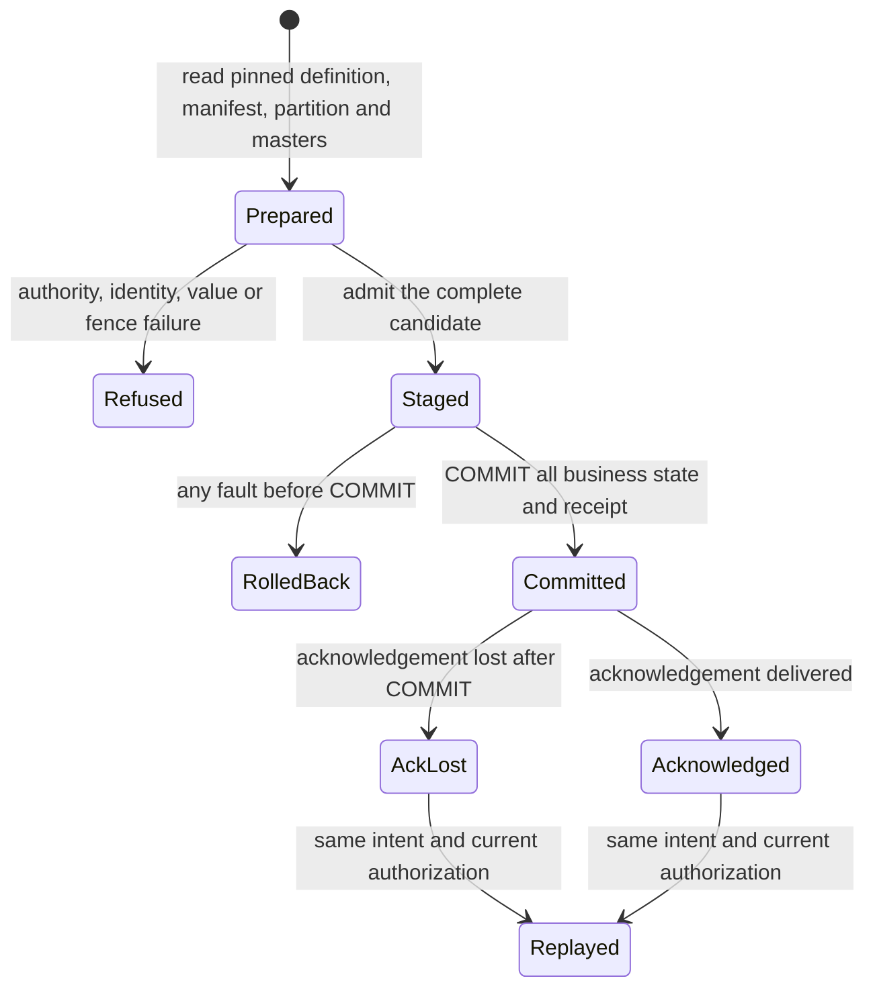

# Declared stock + GL posting transition contract

Executable reference for #214; no implementation correspondence or durability proof.
`cargo test --locked -p norn-kernel --test posting_model`

Refused, RolledBack and Replayed preserve committed state. AckLost has published
everything. Different payloads or definition pins refuse unchanged on retry.

## Named properties

| Property | Required relation | Executable selector |
| --- | --- | --- |
| POST-ATOMIC | Voucher/lines, stock, history, GL, outbox and receipts publish together; refusals and all pre-COMMIT faults preserve them | `post_atomic_every_precommit_fault_preserves_all_business_state` |
| POST-VALUE | Stock deltas equal the valuation fold and event vector; each journal balances; signed stock GL is round2(after value) minus round2(before value), aggregated per warehouse/account | `post_value_rejects_balanced_misvaluation_and_event_mismatch` |
| POST-IDENTITY | One publication per exact intent; conflicting key reuse refuses, including changed pins | `lost_ack_after_commit_is_a_committed_retry` |
| POST-ORDER | Partition and manifest fences, including absent partitions, serialize publication; event order is (ledger position, manifest ordinal) | `post_order_empty_partition_and_manifest_races_are_fenced` |
| POST-AUTHORITY | Current server authorization plus pinned declared-rule authority; no public protected-output setter or weakening inherited law | `post_authority_checks_current_authority_even_for_replay` |

## Feasibility witness: CP1-FIFO

One company/item/warehouse/ownership partition: receive 2 @ 10 + 3 @ 20 in
manifest order. Receipt: Dr stock 80 / Cr SRBNB 80. Deliver 4: Dr COGS 60 /
Cr stock 60; 1 unit worth 20 remains. Quantity/value are integer millionths,
GL cents. `cp1_feasibility_witness` supplies fixed oracle deltas; lane c owns
FIFO allocations, the reference fold and valuation correspondence.

## Named scenarios and abstraction boundaries

- LOST-ACK-AFTER-COMMIT: authorized retry returns the receipt without republishing.
- EMPTY-PARTITION-RACE: two candidates read absence; only the first can commit.
- MANIFEST-EDIT-RACE: editing even an empty owned manifest invalidates a candidate.
- BALANCED-MISVALUE: a balanced journal with the wrong stock leg refuses.
- AGGREGATE-HALF-CENTS: two half-cent line values produce one cent, not two.
- PRE-COMMIT-FAULT: discard staging after voucher, stock/history, GL, outbox or
  receipt. CRASH-REOPEN and MULTILINE-ROLLBACK need actual CellStore conformance.

Bounds: one partition, two racing candidates, five fault stages, small i128
values. Read sets become fences; lifecycle/rule/inheritance become authority
and pins; raw intent becomes representative payload equality. Production must
bind full intent, actor/scope and pins, authorize reads/outputs, and fence
complete manifests/partitions in the transaction. These tests do not prove it.
